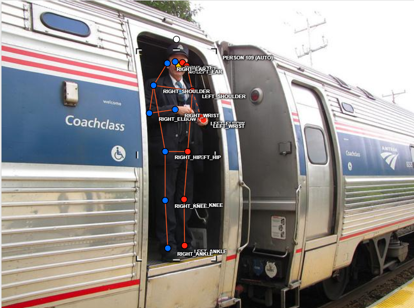
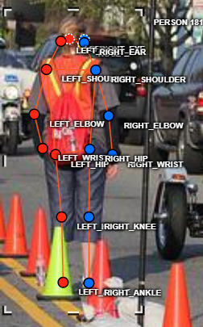
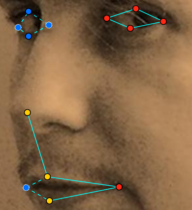
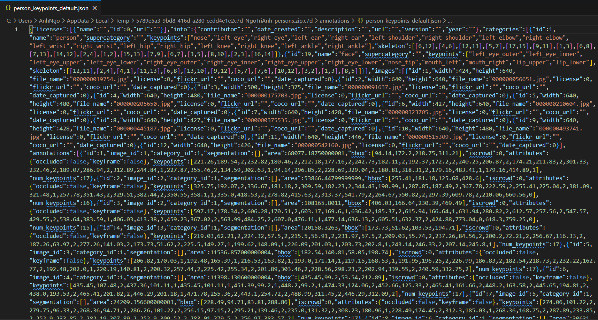

# Báo cáo cá nhân — HoVaTen-MSSV

Đổi tên file theo quy tắc `MSSV_HoTen.md`. Ví dụ: `20241234_NguyenVanAn.md`.

Dữ liệu: 12 ảnh người COCO val2017 (Lin et al., 2014) và 8 ảnh chân dung Wikimedia Commons, chỉ dùng trong lớp.

## 0. Thông tin học viên

- Họ tên: Ngô Trí Anh
- MSSV: 2A202604053
- Email: ngotrianh196@gmail.com
- Link repository: https://github.com/AnhNgo1702/K5-L2B-DAY04-NgoTriAnh-2A202604053-KeypointPose-Student.git
- Phiên bản CVAT (Help → About): 2.74.1
- Máy: hệ điều hành Windows · RAM 16 GB · chạy CVAT chế độ đầy đủ
- Bộ ảnh (`src/exports/assignment.json` do `lab.py setup` tạo): có
- Giờ bắt đầu: 5h30
- Giờ kết thúc: 7h30

## 1. Kiểm tra label (CP0)

| Label | Kiểu | Số điểm | Tên điểm đúng bảng của lab? | Đúng thứ tự? | Số cạnh |
|---|---|---:|---|---|---:|
| `person` | Skeleton | 17 | Có | Có | 19 |
| `face` | Skeleton | 13 | Có | Có | 13 |

Mẫu `person` dựng theo người quay mặt về camera (các điểm `left_*` nằm bên phải khung mẫu)? Có

Cách đổi cờ `occluded` / `outside` cho **một điểm** trên phiên bản CVAT này (một câu):

Rê chuột vào đúng điểm (điểm sáng lên), rồi bấm `Q` để đổi `occluded` hoặc bấm `O` để đổi `outside`, hoặc chuột phải vào điểm để mở menu có 4 nút.

## 2. Số lượng đã gán và thời gian (CP1, CP2)

| Nhóm ảnh | Số ảnh | Số skeleton đã gán | Số người dưới 60 px (không gán) | Số poster / gương / màn hình bỏ qua | Thời gian (phút) |
|---|---:|---:|---:|---:|---:|
| `easy` | 5 |5 |0 |0 |20 |
| `occluded` | 3 |5 |0 |0 |20 |
| `back` | 2 |3 |0 |0 |15 |
| `small` | 1 |1 |1 |0 |10 |
| `crowd` | 1 |1 |3 |1 |15 |
| `faces` | 8 |8 | — |0 |20 |

- Số ảnh người đã xong ở mốc phút 105: 10 / 10
- Thời gian thực tế (phút): CP1 45 · CP2 45 · CP3 
- Ảnh tốn thời gian nhất là ảnh nào, vì sao?

Ảnh 000000375535.jpg và 000000542160.jpg Do có nhiều người bị che khuất một phần lớn cơ thể, các khớp bị chồng chéo lên nhau, đòi hỏi phải suy luận kỹ hướng quay của cơ thể

## 3. Bảng ca khó (CP1, CP2)

Mỗi điểm bạn phân vân một dòng, nhất là phân vân giữa `v = 1` và `v = 0`, hoặc không chắc hướng người.

| Ảnh | Người / mặt | Điểm | Cờ đã chọn | Phân vân giữa | Lý do chọn |
|---|---|---|---:|---|---|
|000000515309.jpg |Person 289 |right hip |v=2 |v=2 và outside |mặc dù mờ nhưng em phỏng đoán nhìn thấy phần body và một chút phần chân trong khung hình nên right hip vẫn chưa ra khỏi khung hình |
|000000542160.jpg |Person 325 |right knee |v=2 |v=1 và v=2 |Đầu gối bị khuất nhẹ bởi ống quần nhưng cấu trúc chân rõ ràng, xác định được tâm khớp nên chọn v=2 |
|000000205650.jpg |Person 109 |left ear |v=2 |v=1 và v=2 |Vành tai bị che một phần bởi góc chụp nghiêng của đầu nhưng vẫn thấy 1 phần của tai |

## 4. Bảng tự review (CP3)

Đi từ ảnh cuối về ảnh đầu. 5 ảnh người (ít nhất 2 ảnh `back` hoặc `crowd`) và 3 ảnh mặt. Ít nhất 8 dòng, kể cả dòng `ok`. Ghi lỗi trước, sửa sau.

Mã lỗi dùng đúng một trong: `lr_swap`, `vis_flag`, `position`, `missing`, `extra`, `ok`.

| Ảnh | Người / mặt | Điểm | Mã lỗi | Ghi chú | Đã sửa? |
|---|---|---|---|---|---|
|000000542160.jpg |Person 325 |right knee |ok |Tư thế chân bắt chéo thực tế, không bị lỗi gán ngược. |Có |
|000000323705.jpg |Person 163 |left eye |ok |Người quay lưng nhưng quay đầu nhìn máy ảnh, gán đúng theo thân người. |Có |
|000000019754.jpg |Person 1 |right wrist |lr_swap |Ban đầu nhầm lẫn tay trái/phải do góc lật người trên không, đã đổi lại. |Có |
|000000210604.jpg |Person 145 |right hip |vis_flag |Đặt nhầm cờ hiển thị occluded do nhìn nhầm tưởng điểm đã bị che |Có |
|000000515309.jpg |Person 271 |right ankle |position |Tâm điểm mắt cá chân bị lệch nhẹ khỏi vị trí xương thực tế, đã dịch chuyển lại. |Có |
|face_416730 |Face 99 |left eye outer |vis_flag |Vị trí mắt trái lúc đầu lầm tưởng là đã bị che nên gán occluded |Có |
|face_155465 |Face 15 |nose |ok |Gán đúng tâm chóp mũi trên khuôn mặt trực diện. |Có |
|face_223746 |Face 43 |right eye inner |vis_flag |Điểm mắt phải trong bị che bởi sống mũi nhưng lúc đầu không để ý |Có |

Tổng hợp số lỗi theo mã:

| `lr_swap` | `vis_flag` | `position` | `missing` | `extra` | `ok` |
|---:|---:|---:|---:|---:|---:|
|1 |3 |1 |0 |0 |3 |

Điểm còn phân vân giữa `v = 1` và `v = 0` (ghi cả hai lựa chọn và lý do chọn):

Các điểm khuất ngoài khung hình được gán v = 0 (outside) với tọa độ giữ nguyên theo quy chuẩn CVAT 2.x; các điểm bị che bởi vật cản hoặc cơ thể khác nhưng ước lượng được vị trí thì chọn v = 1 (occluded) để model tận dụng thông tin ngữ cảnh.

## 5. Kiểm file xuất và kết quả tự kiểm (CP4)

Sau khi xuất, CVAT ghi `occluded` thành `v = 1` và `outside` thành `v = 0`. Tọa độ của điểm `outside` trong file là tọa độ cũ (CVAT 2.x xuất như vậy; chuẩn COCO ghi 0, 0).

Hai job đã chuyển sang completed trên CVAT? Có

Dán phần **TÓM TẮT** in ra từ `src/check_submission.py`:

```text
- File person: NgoTriAnh_persons.zip
  Số ảnh: 12 · số skeleton `person`: 20 · mỗi annotation 51 số
  Skeleton theo ảnh: 000000019754=1, 000000056651=2, 000000091637=2, 000000175703=1, 000000205650=1, 000000210604=2, 000000323705=1, 000000375535=3, 000000445187=1, 000000493741=1, 000000515309=2, 000000542160=3
  Cờ v: v=2 243 (71%) · v=1 94 (28%) · v=0 3 (1%)
  num_keypoints trung bình: 16.9

- File face: NgoTriAnh_faces.zip
  Số ảnh: 8 · số skeleton `face`: 8 · mỗi annotation 39 số
  Skeleton theo ảnh: face_10579=1, face_155465=1, face_178208=1, face_223746=1, face_256814=1, face_279764=1, face_359139=1, face_416730=1
  Cờ v: v=2 101 (97%) · v=1 3 (3%) · v=0 0 (0%)
  num_keypoints trung bình: 13.0

- Ghi chú: 3 điểm v = 0 vẫn mang tọa độ cũ (CVAT 2.x xuất như vậy; chuẩn COCO ghi 0, 0). Không phải lỗi: điểm v = 0 bị bỏ qua khi huấn luyện và khi chấm.

- Số [LỖI]: 0 · số [CẢNH BÁO]: 4

Kết quả: ĐẠT
```

Các `[CẢNH BÁO]` còn giữ nguyên và lý do:

- [CẢNH BÁO] 000000019754.jpg #1: cặp wrist nằm ngược phía so với các cặp còn lại. Có thể đổi trái/phải một cặp (`lr_swap`), hoặc tay / chân bắt chéo thật: kiểm lại.
  
  **Lý do giữ:** Đã kiểm tra lại, tay người thật sự bắt chéo (tay phải chìa qua phía trái), không phải lỗi gán.

- [CẢNH BÁO] 000000323705.jpg #1: thấy rõ mũi và hai mắt (v = 2) nhưng các điểm left nằm bên TRÁI ảnh, tức là gán như người quay lưng. Kiểm lại hướng người (`lr_swap` cả người?).
  
  **Lý do giữ:** Người thật sự đang quay lưng về camera, chỉ quay đầu lại nên nhìn thấy mặt. Gán đúng theo quy tắc trái/phải của người.

- [CẢNH BÁO] 000000542160.jpg #1: thấy rõ mũi và hai mắt (v = 2) nhưng các điểm left nằm bên TRÁI ảnh, tức là gán như người quay lưng. Kiểm lại hướng người (`lr_swap` cả người?).
  
  **Lý do giữ:** Người đang quay lưng về camera, chỉ quay đầu lại. Gán đúng theo hướng thân người.

- [CẢNH BÁO] 000000542160.jpg #2: cặp knee, ankle nằm ngược phía so với các cặp còn lại. Có thể đổi trái/phải một cặp (`lr_swap`), hoặc tay / chân bắt chéo thật: kiểm lại.
  
  **Lý do giữ:** Đã kiểm tra, chân người thật sự bắt chéo do tư thế đứng, không phải lỗi gán.

## 6. Ảnh chụp màn hình

1. Label `person` trong label constructor (đủ 17 điểm có tên):

   

2. Một người quay lưng đã gán, cờ đã đặt:

   

3. Một khuôn mặt đã gán 13 điểm, phóng to vùng mắt:

   

4. Một đoạn JSON xuất của một người:

   

Nguồn ảnh: COCO val2017 / Wikimedia Commons.

## 7. Tự đánh giá

1. Lỗi bạn mắc nhiều nhất hôm nay, và cách bạn sẽ tránh ở dự án thật:

   Lỗi mắc phải nhiều nhất là đặt nhầm cờ hiển thị (vis_flag) hoặc nhầm lẫn trái/phải (lr_swap) ở những góc chụp người xoay lưng hoặc lật người trên không trung. Ở dự án thật, cần bật tính năng kiểm tra trực quan xương (skeleton connection) ngay từ bước gán và thực hiện bước rà soát kỹ lưỡng bằng công cụ tự động

2. Một quy tắc bạn đề xuất thêm vào guideline (kèm ảnh ví dụ nếu có):

   Đối với các tư thế thể thao động lực học cao (như trượt ván, nhào lộn), nếu khớp bị che khuất hoàn toàn bởi ván hoặc dụng cụ thi đấu nhưng có thể suy luận qua trục xương đối xứng, nên ưu tiên gán nhãn ở trạng thái $v = 1$ thay vì bỏ qua ($v = 0$) để giữ độ mượt cho bộ dữ liệu chuyển động.

3. Nhãn của bạn đi vào model ở đâu? Chọn một lỗi bạn đã sửa và nói nó sẽ làm model học sai thế nào (heatmap, trọng số trong loss, hay bước lật ảnh):

   Lỗi position (lệch vị trí tâm khớp cổ tay/mắt cá chân) sẽ làm ảnh hưởng trực tiếp đến việc sinh heatmap trong quá trình huấn luyện. Nếu tọa độ gán bị lệch, tâm của phân phối Gaussian trên heatmap sẽ bị sai lệch, khiến model dự đoán ra các tọa độ tọa độ bị nhiễu, làm giảm độ chính xác khi suy luận.

## 8. Khó khăn và lỗi kỹ thuật

Quá trình cấu hình và chạy CVAT trên Windows diễn ra suôn sẻ. Khó khăn lớn nhất nằm ở việc nhận diện chính xác các góc khuất cơ thể trong ảnh tập trung đông người

## Bonus (nếu làm)

### B1 — 3 ảnh người khó thêm

| Ảnh | Số skeleton | Số người dưới 60 px | Ca khó nhất |
|---|---:|---:|---|
| | | | |
| | | | |
| | | | |

Kết quả `src/check_submission.py` cho `HoVaTen_bonus_persons.zip`:

```text
(dán ở đây)
```

### B2 — 5 ảnh khuôn mặt đen trắng / hồng ngoại

Ảnh không màu khó hơn ở điểm nào? Kính râm trên ảnh hồng ngoại có còn là `v = 1` không?

...

### B3 — Model so với nhãn của tôi (không tính điểm)

- Demo đã dùng:
- Ảnh đã thử:

1. Model có trả điểm cho khớp bị che, hay khớp ngoài ảnh không? Confidence ở các điểm đó thế nào?

   ...

2. Với người quay lưng, model có đổi trái/phải không?

   ...

3. Bộ điểm của model có giống 17 điểm COCO không?

   ...

## 9. Tài liệu tham khảo và công cụ AI đã dùng

...
